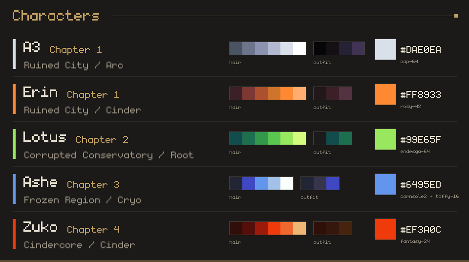

 

 

<i>Sunlight through a broken roof. Wind in the grass that grew over the road. 
Somewhere amidst the overgrowth, a machine remains vigilant; keeping watch.</i>

 

**Reverse Shell** is a narrative RPG with tactical card combat, set amidst a world humanity is leaving behind.

Long ago, people found a way to live forever. The **Reverse Shell** process records the user's mind onto a
**Soul Card** and places it in a mechanical body built to outlast anything. *Any environment. No hunger. No death.
No fear.*

You wake alone beside a cracked capsule. You're a machine with a human's name that you can barely remember. Explore
the ruins, meet the machines that outlived their makers, and face the guardian (who will not remain that sprite LOL)
at the heart of the ruins!

<table>
  <tr>
    <td width="50%"></td>
    <td width="50%"></td>
  </tr>
</table>

<b><a href="https://silvered.itch.io/reverse-shell-demo">▶ Play the FREE Chapter One demo in your browser!!1!!1!</a></b> 
this is like all subject to change btw :3

| Character | Chapter | Home area | Resonance | Who they are |
|---|---|---|---|---|
| **A3** | 1 | Ruined City | Arc, then one more each chapter | You: a machine with a human's name, waking up alone |
| **Erin** | 1 | Ruined City | Cinder | Your first companion; she teaches you to fight |
| **Lotus** | 2 | Corrupted Conservatory | Root | Poison and earth |
| **Ashe** | 3 | Frozen Region | Cryo | The healer |
| **Zuko** | 4 | Cindercore | Cinder | All offense, no healing |

<b>Colour palettes</b> (exact hex codes, dark to light)

Every party colour comes from a [Lospec](https://lospec.com/palette-list) palette. Every character shares one body
and is told apart by their hair, eyes, outfit and accent (the trim and highlights, the card swirl and glow).

| Character | Hair | Eyes | Outfit | Accent | Lospec palette |
|---|---|---|---|---|---|
| **A3** | `#4A5462` `#6D758D` `#8B93AF` `#B3B9D1` `#DAE0EA` `#FFFFFF` | `#DAE0EA` `#FFFFFF` | `#060608` `#141013` `#242234` `#403353` | `#DAE0EA` | [AAP-64](https://lospec.com/palette-list/aap-64) |
| **Erin** | `#3B2027` `#7D3833` `#AB5130` `#CF752B` `#FF8933` `#FFAE70` | `#AB5130` `#FF8933` | `#21181B` `#3B2027` `#52333F` | `#FF8933` | [Rosy 42](https://lospec.com/palette-list/rosy-42) |
| **Lotus** | `#134C4C` `#1E6F50` `#33984B` `#5AC54F` `#99E65F` `#D3FC7E` | `#1E6F50` `#99E65F` | `#1B1B1B` `#134C4C` `#1E6F50` | `#99E65F` | [Endesga 64](https://lospec.com/palette-list/endesga-64) |
| **Ashe** | `#222533` `#3F48C2` `#6495ED` `#A3C0E6` `#FAFFFC` | `#3F48C2` `#A3C0E6` | `#222533` `#36354D` `#3F48C2` | `#6495ED` | [Cornsole2](https://lospec.com/palette-list/cornsole2) + [Taffy 16](https://lospec.com/palette-list/taffy-16) |
| **Zuko** | `#300F0A` `#550F0A` `#9B1A0A` `#EF3A0C` `#EF692F` `#EFB775` | `#9B1A0A` `#EF692F` | `#300F0A` `#36170C` `#45230D` | `#EF3A0C` | [Fantasy 24](https://lospec.com/palette-list/fantasy-24) |

- **Ashe's cornflower is exactly `#6495ED`** (RGB 100, 149, 237) everywhere: hair, card swirl and glow.
- **A3's hair and eyes are white.** The game tints them in her active resonance's colour, so draw them in these greys.
- The same colours as `.hex` files (one per line, they load straight into Aseprite or Lospec) are in
  [`reverse-shell/Tools/ChibiForge/palettes/`](reverse-shell/Tools/ChibiForge/palettes/).

- **Plan, then press Go.** Each fighter standing gives you 1 AP (action point), the squares at the top. Playing a
  card or rearranging a card in your hand both cost 1 AP.
- **Merge your cards!** Organize your hand to match cards, upgrade them, and build up your soul card!
- **Break their guards!** Every enemy has a weakness, which you can exploit to stagger them--and do large amounts of
  damage.
- **Soul Cards finish what attacks can't.** Fill a member's Ult and their Soul Card joins your hand.
- **Every blow lands.** The camera pushes in on each attack and the hit freezes for a moment as it connects.
- **Can you read your own cards?** They're written in an alien alphabet until you find the language chip... or
  learn to read it yourself.
- **Read the field.** Hold any card or unit to see more information.

- **Chapter One: Ruined City.** Wake up alone, piece together records and memory fragments, follow a scanner
  trace through the ruins, face the Collector, and find what the guardian is protecting.
- **Erin's tutorial.** Erin joins you before the Collector and teaches you to fight on a training robot: tap, merge,
  BREAK, then finish it with your Soul Card. Then she fights the Collector beside you.
- **Sandbox Mode** (on the title screen): practice fights at any enemy level with the whole test crew: **Ashe**, who's
  ice now (Absolute Zero, Leng Storm 冷, Whiteout), plus **Lotus** and **Zuko**, who only join here until their bonds
  are written.
- A pause menu dealt out as real cards, three save slots, Fast or Pretty graphics, Text Speed and Auto-Advance, and
  **Machine Look** (the machines in Snoblin's or Tech Dungeon's style).

<b>New in Demo v1.0</b>

- A new opening scene and a new ending for Chapter One (no spoilers).
- New sprites for the crew, each in their own Lospec palette; A3's hair and eyes take her resonance's colour.
- Hits land on the strike frame with a short hit-stop; a bigger BREAK; a victory beat before the results.
- Text Speed, Auto-Advance, and hold Space / Enter / F to skip dialogue you've already read.
- A new loading screen, and a thank-you screen at the end of the chapter with a look at Chapter Two.
- Sandbox Mode has its own save with the whole crew; your story save keeps only who has joined you.

<table>
  <tr>
    <td width="50%"></td>
    <td width="50%"></td>
  </tr>
  <tr>
    <td></td>
    <td></td>
  </tr>
  <tr>
    <td></td>
    <td></td>
  </tr>
  <tr>
    <td></td>
    <td></td>
  </tr>
  <tr>
    <td></td>
    <td></td>
  </tr>
  <tr>
    <td></td>
    <td></td>
  </tr>
</table>

| Key | Does |
|---|---|
| **WASD / arrows** | walk (hold **Shift** to run) |
| **F** | talk, open, interact |
| **Q** | scan (once you have the scanner) |
| **Click** a card | play it (1 AP) |
| **Drag** a card | move it, or merge it (1 AP) |
| **Hold** a card or unit | read it (an enemy: its Break and weaknesses) |
| **Go / Enter** | play the turn |
| **Tab** | cycle speed up |
| **Hold Space / Enter / F** | skip dialogue you've already read |
| **Esc or P** | menu (in browser fullscreen, Esc leaves fullscreen, so use P) |

The full list is in **Settings → Tutorials**.

1. Open `reverse-shell/` in **Unity 2019.4.14f1** (C# 7.3).
2. Run **Tools → Combat → Generate Sample Content**, then **Reverse Shell → Bug Sweep**, and pray nothing goes wrong.
3. Make sure **Tools → Overworld → Always Play From Overworld** is checked, then press Play.
4. For the web build: **Reverse Shell → Build Web Demo** (or **Web Build Setup**, then **File → Build Settings →
   WebGL → Build**). Zip the output with `index.html` at the root!

> **Some art isn't in this repo.** The party's sprites, the machines' sprites, the effects pack, the icon pack and the card packs can't be
> redistributed (see [THIRD_PARTY.md](THIRD_PARTY.md)), so a fresh clone opens and compiles but shows those as
> missing. The code, the tools and everything they draw are here.

<b>Project layout</b>

| Path | What's there |
|---|---|
| `reverse-shell/Assets/_Project/Scripts/` | Combat, the overworld, story and UI code |
| `reverse-shell/Assets/_Project/Resources/Story/` | The script: `Chapter1.txt`, `World.txt`, `Guide.txt` (plain text, loaded at runtime) |
| `reverse-shell/Assets/_Project/Art/` | Characters, portraits, tiles and third-party art (each with a `CREDITS.md`) |
| `reverse-shell/Assets/WebGLTemplates/InkGold/` | The web build's loading page |
| `reverse-shell/Tools/` | Python generators: CardForge, ChibiForge, IconForge, MapForge, PortraitForge, TileForge, ItchArt… |
| `reverse-shell/Tools/CardForge/` | The card pipeline: card spreadsheet → `cards.json` → Unity's card import, plus the Google Sheets export/import |
| `reverse-shell/Tools/CardEditor/` | A local web page for editing the card spreadsheet (`py Tools/CardEditor/server.py`) |

Made by **Oliver Pearce**. A free, non-commercial fan game inspired by *Reverse: 1999* (not affiliated with Bluepoch).

- **Party sprites:** A2 from *Last Cloudia* (NieR:Automata collab), © Aidis Inc. / Square Enix. Fan use, not affiliated
  (not included in this repo)
- **Machines and NPCs:** [Pixel RPG Prototype Characters](https://snoblin.itch.io/pixel-rpg-free-npc) by Snoblin and
  [Tech Dungeon Roguelite](https://trevor-pupkin.itch.io/tech-dungeon-roguelite) by Trevor Pupkin (switch in Settings →
  Machine Look; not included in this repo)
- **Effects:** [Super Pixel Effects Gigapack](https://untiedgames.itch.io/super-pixel-effects-gigapack) by Will Tice / unTied Games
- **Icons:** [Raven Fantasy Icons](https://clockworkraven.itch.io/raven-fantasy-icons) by Clockwork Raven Studios
- **Card packs:** Free Card Packs by argametina
- **Nature models:** [Stylized Nature MegaKit](https://quaternius.com) by Quaternius (CC0)
- **Font:** [monogram](https://datagoblin.itch.io/monogram) by datagoblin (CC0)
- **Party colours:** [Lospec](https://lospec.com/palette-list) palettes AAP-64 (Adigun A. Polack), Rosy 42, Endesga 64 (ENDESGA), Cornsole2, Taffy 16, Fantasy 24
- **Tiles (early builds):** [Cyber City](https://opengameart.org/content/cyber-city) by warlloyd (CC0)

The code is [MIT](LICENSE.md). Third-party art keeps its own licence and isn't covered by it: see
[THIRD_PARTY.md](THIRD_PARTY.md) and each folder's `CREDITS.md`.
