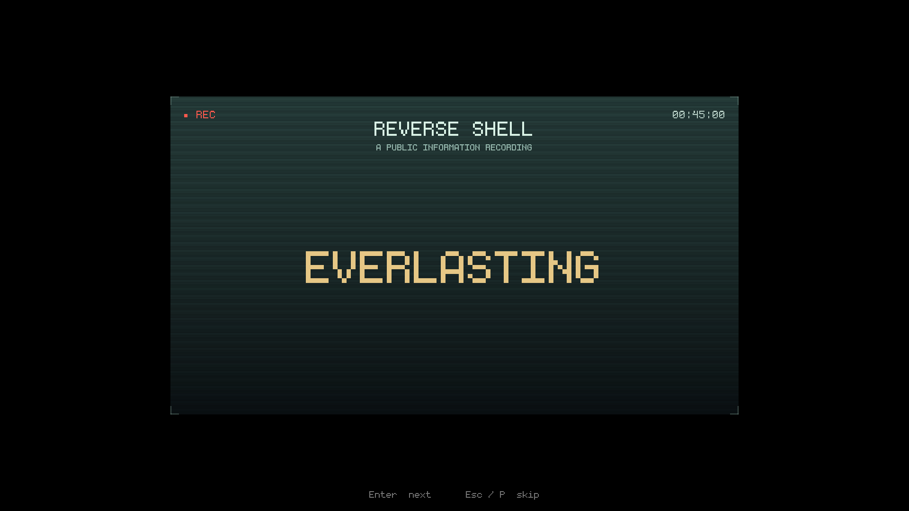
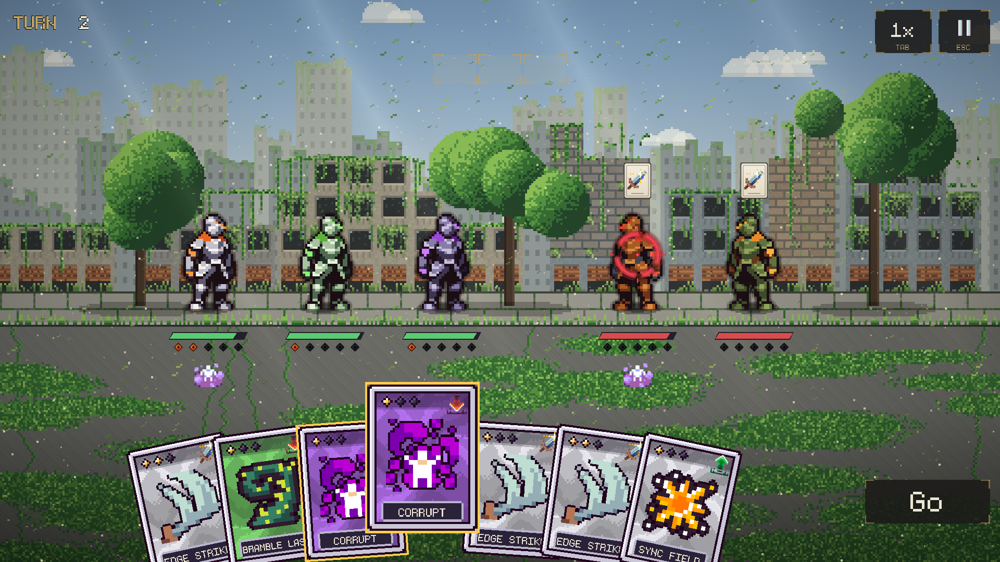
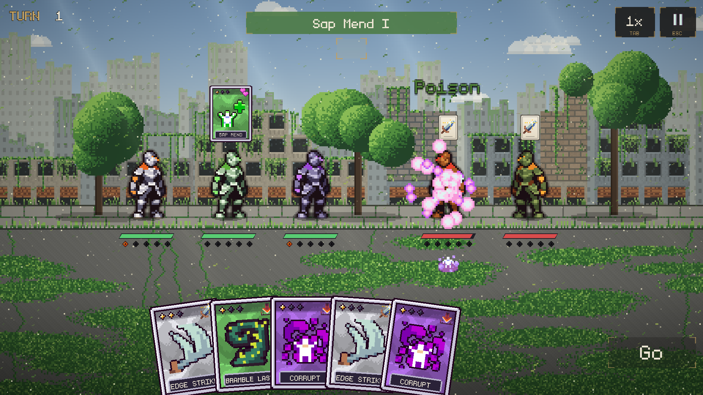
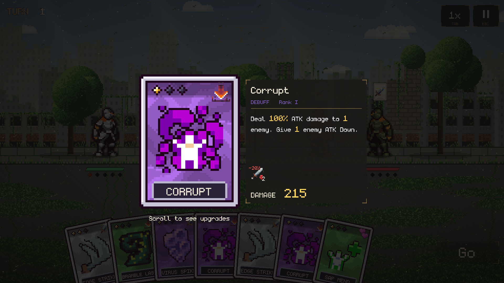
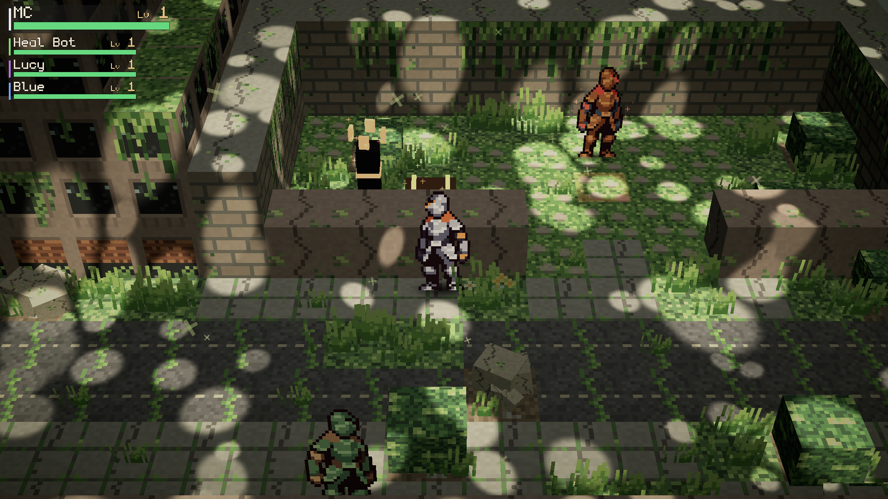

 

  

<i>Sunlight through a broken roof. Wind in the grass that grew over the road. 
Somewhere amidst the overgrowth, a machine remains vigilant; keeping watch.</i>

 

**Reverse Shell** is a narrative RPG with tactical card combat, set in a beautiful world humanity left behind.

Long ago, people found a way to live forever. The **Reverse Shell** process records the user's mind onto a
**Soul Card** and places it in a mechanical body built to outlast anything. *Any environment. No hunger. No death.
No fear.*

You wake alone beside a cracked capsule. You're a machine with a human's name that you can barely remember. Explore
the ruins, meet the machines that outlived their makers, and face the guardian (who will not remain that sprite LOL)
at the heart of Mossline.

<b><a href="https://silvered.itch.io/reverse-shell-demo">▶ Play the free Chapter One demo in your browser</a></b> 
this is like all subject to change btw :3

- **Plan, then press Go.** Each fighter standing gives you 1 AP, or Action Point. Playing a card or rearranging a
  card in your hand both cost 1 AP.
- **Merge cards.** Drag a card next to a matching one and they fuse into a stronger rank.
- **Charge your Ultimate.** Cards build Ult pips, which let you play your Soul Card, an ability unique to every unit.
- **Interact with the field.** Click and hold any card or unit to see its numbers, statuses and upgrades.

<table>
  <tr>
    <td width="33%"></td>
    <td width="33%"></td>
    <td width="33%"></td>
  </tr>
  <tr>
    <td align="center">Drag to merge</td>
    <td align="center">Watch the turn play out</td>
    <td align="center">Hold to read</td>
  </tr>
</table>

- **Chapter One: The Overgrown City.** Wake up alone, piece together records and memory fragments, follow a scanner
  trace through the ruins, face the Collector, and find what the guardian is protecting.
- **Sandbox Mode** (title screen, or Esc → Settings): practice fights at any enemy level with the whole test crew,
  including **Heal Bot**, who keeps everyone running, and **Lucy**, who *infects* things.
- A pause menu dealt out as real cards, three save slots, and Fast or Pretty graphics.

<table>
  <tr>
    <td width="50%"></td>
    <td width="50%"></td>
  </tr>
  <tr>
    <td></td>
    <td></td>
  </tr>
  <tr>
    <td colspan="2" align="center"></td>
  </tr>
</table>

| Key | Does |
|---|---|
| **Click the game once** | gives it keyboard focus (in the browser) |
| **WASD / arrows** | walk (hold **Shift** to run) |
| **F** | talk, open, interact |
| **Q** | scan (once you have the scanner) |
| **Esc** or **P** | menu (in browser fullscreen, Esc leaves fullscreen, so use **P**) |
| **Click** a card | play it (1 AP) |
| **Drag** a card | move it, or merge it (1 AP) |
| **Hold** a card or unit | read it |
| **Go** / **Enter** | play the turn |
| **Tab** | battle speed |

The full list is in **Settings → Tutorials**.

1. Open `reverse-shell/` in **Unity 2019.4.14f1** (C# 7.3).
2. Open `Assets/_Project/Scenes/Overworld_Mossline.unity` and press Play. `Battle.unity` is loaded from it.
3. For the web build: **Reverse Shell → Web Build Setup**, then **File → Build Settings → WebGL → Build**.
   Zip the output with `index.html` at the root for itch.io.

<b>Project layout</b>

| Path | What's there |
|---|---|
| `reverse-shell/Assets/_Project/Scripts/` | Combat, the overworld, story and UI code |
| `reverse-shell/Assets/_Project/Resources/Story/` | The script: `Chapter1.txt`, `World.txt`, `Guide.txt` (plain text, loaded at runtime) |
| `reverse-shell/Assets/_Project/Art/` | Characters, portraits, tiles and third-party art (each with a `CREDITS.md`) |
| `reverse-shell/Tools/` | Python generators: CardForge, ChibiForge, IconForge, MapForge, PortraitForge, TileForge… |

Made by **Oliver Pearce**. A free, non-commercial fan game inspired by *Reverse: 1999* (not affiliated with
Bluepoch).

- **Icons:** [Raven Fantasy Icons](https://clockworkraven.itch.io/raven-fantasy-icons) by Clockwork Raven Studios
- **Character sprites:** Fantasy Knight by aamatniekss
- **Effects:** [Super Pixel Effects Gigapack](https://untiedgames.itch.io/super-pixel-effects-gigapack) by Will Tice / unTied Games
- **Tiles:** [Cyber City](https://opengameart.org/content/cyber-city) by warlloyd (CC0)
- **Font:** monogram by datagoblin

Third-party art keeps its own licence (see each `CREDITS.md`), and isn't covered by any licence on this repository.
