

<a href="https://silvered.itch.io/reverse-shell-demo">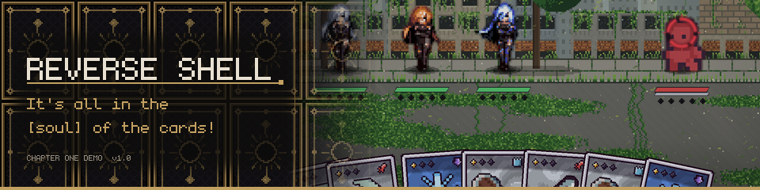</a>

 

 

<i>Sunlight through a broken roof. Wind in the grass that grew over the road. 
Somewhere amidst the overgrowth, a machine remains vigilant; keeping watch.</i>

 

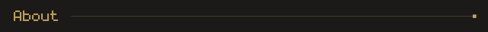

**Reverse Shell** is a narrative RPG with tactical card combat, set amidst a world humanity is leaving behind.

Long ago, people found a way to live forever. The **Reverse Shell** process records the user's mind onto a
**Soul Card** and places it in a mechanical body built to outlast anything. *Any environment. No hunger. No death.
No fear.*

You wake alone beside a cracked capsule. You're a machine with a human's name that you can barely remember. Explore
the ruins, meet the machines that outlived their makers, and face the guardian (who will not remain that sprite LOL)
at the heart of the ruins!

<table>
  <tr>
    <td width="50%">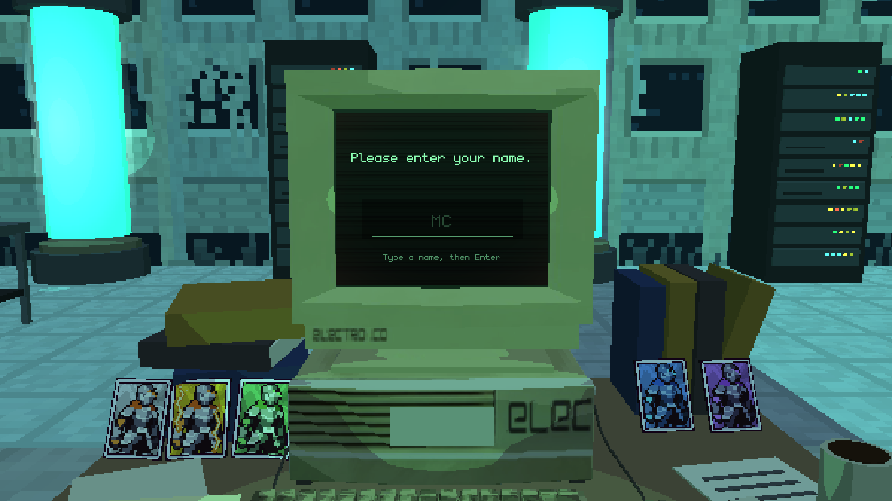</td>
    <td width="50%">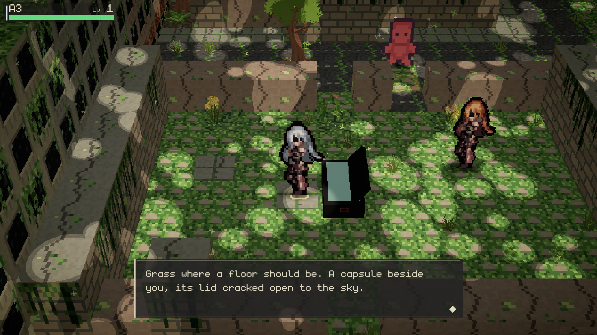</td>
  </tr>
</table>

<b><a href="https://silvered.itch.io/reverse-shell-demo">▶ Play the FREE Chapter One demo in your browser!!1!!1!</a></b> 
this is like all subject to change btw :3

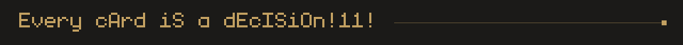

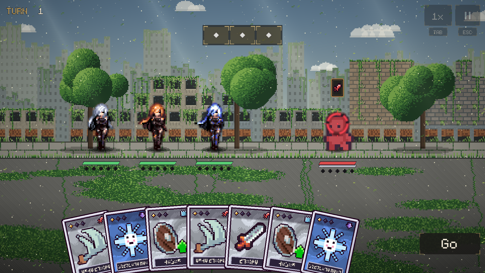

- **Plan, then press Go.** Each fighter standing gives you 1 AP (action point). Playing a card or rearranging a
  card in your hand both cost 1 AP.
- **Merge your cards!** Organize your hand to match cards, upgrade them, and build up your soul card!
- **Break their guards!** Every enemy has a weakness, which you can exploit to stagger them--and do large amounts of damage.
- **Read the field.** Hold any card or unit to see more information.

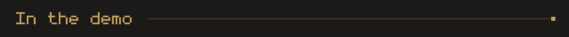

- **Chapter One: Ruined City.** Wake up alone, piece together records and memory fragments, follow a scanner
  trace through the ruins, face the Collector, and find what the guardian is protecting.
- **Sandbox Mode** (title screen, or **Esc → Settings**): practice fights at any enemy level with the whole test crew,
  including **Ashe**, who keeps everyone running, and **Lucy**, who *infects* things. (cyberpunk s2 anyone??)
- A pause menu dealt out as real cards, three save slots, and Fast or Pretty graphics.

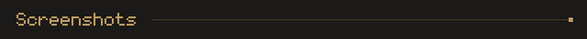

<table>
  <tr>
    <td width="50%">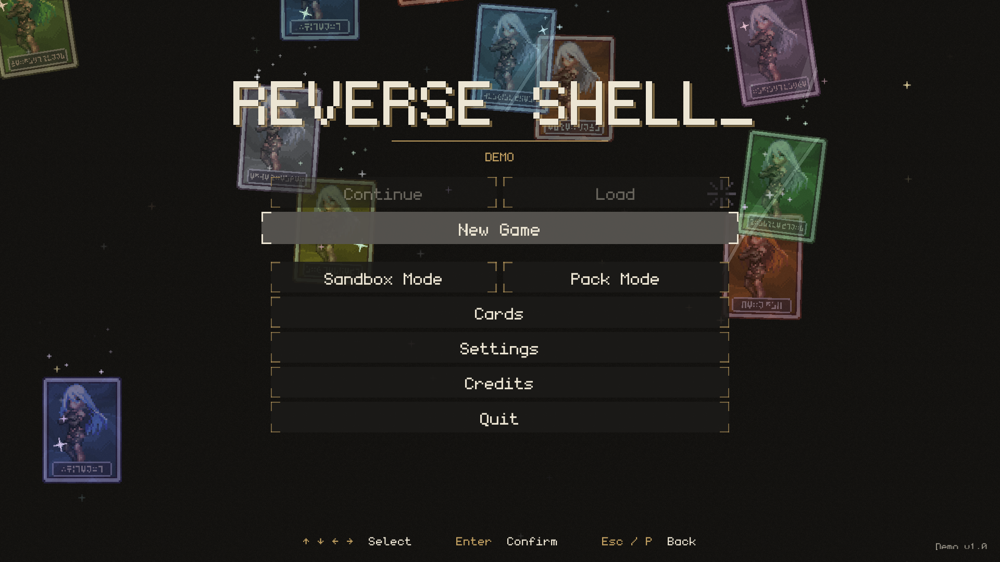</td>
    <td width="50%">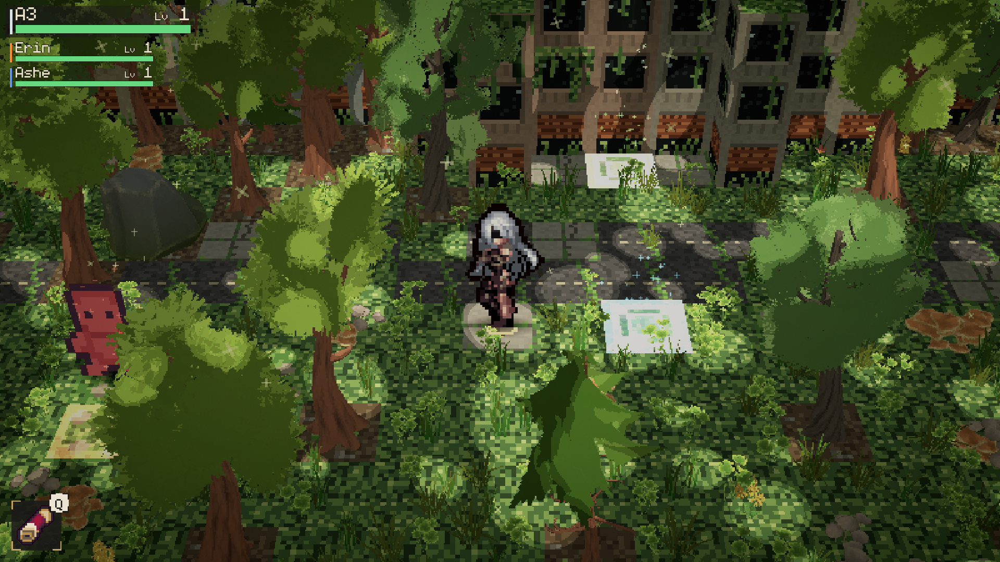</td>
  </tr>
  <tr>
    <td>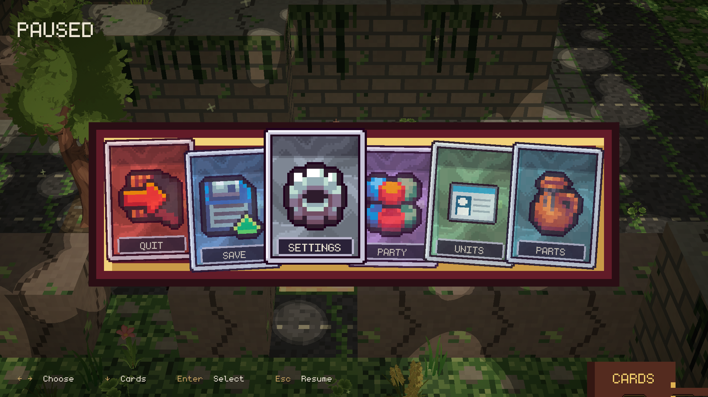</td>
    <td>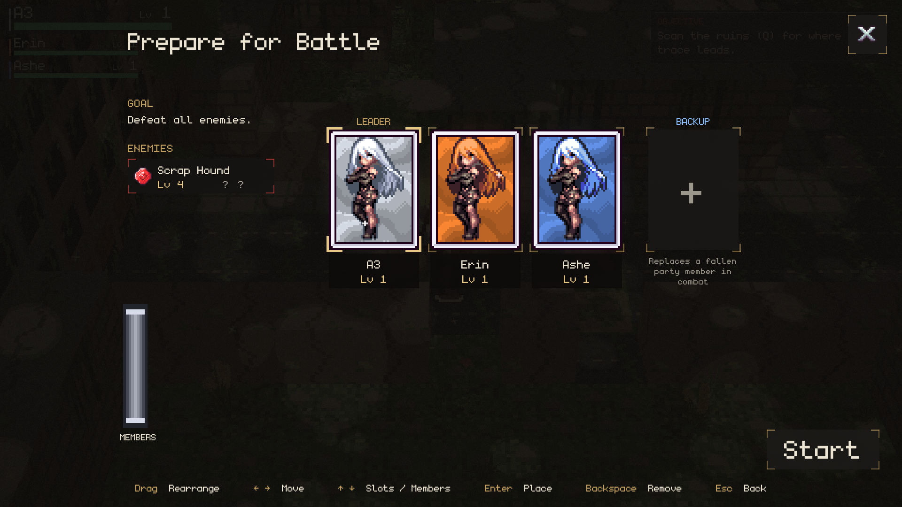</td>
  </tr>
  <tr>
    <td colspan="2" align="center">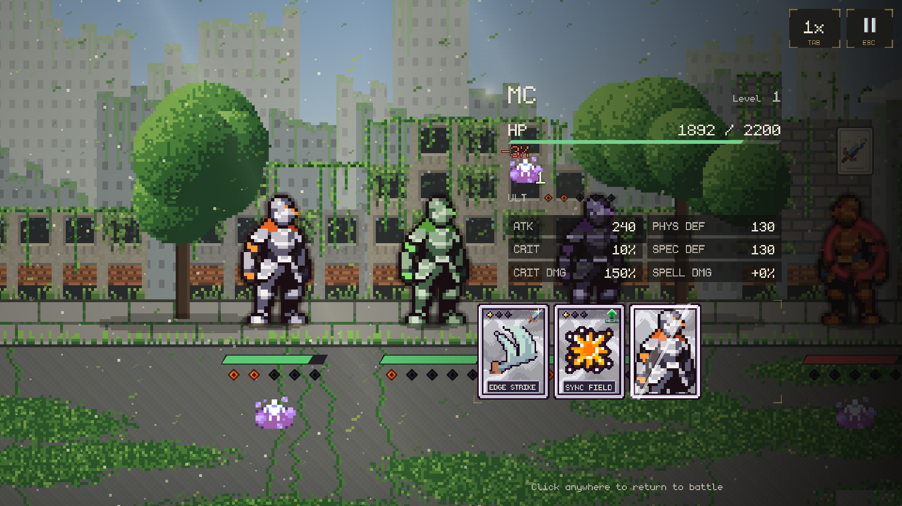</td>
  </tr>
</table>

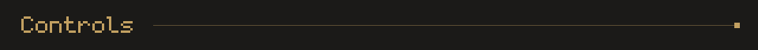

| Key | Does |
|---|---|
| **WASD / arrows** | walk (hold **Shift** to run) |
| **F** | talk, open, interact |
| **Tab** | cycle speed up |
| **Esc or P | menu (in browser fullscreen, Esc leaves fullscreen, so use P) |

The full list is in **Settings → Tutorials**.

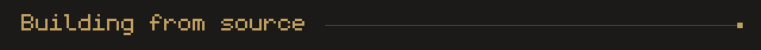

1. Open `reverse-shell/` in **Unity 2019.4.14f1** (C# 7.3).
2. Open `reverse-shell/check-cards` and pray nothing goes wrong.
3. Make sure `reverse-shell/play-from-title` is checked.
4. For the web build: **Reverse Shell → Web Build Setup**, then **File → Build Settings → WebGL → Build**.
   Zip the output with `index.html` at the root!

<b>Project layout</b>

| Path | What's there |
|---|---|
| `reverse-shell/Assets/_Project/Scripts/` | Combat, the overworld, story and UI code |
| `reverse-shell/Assets/_Project/Resources/Story/` | The script: `Chapter1.txt`, `World.txt`, `Guide.txt` (plain text, loaded at runtime) |
| `reverse-shell/Assets/_Project/Art/` | Characters, portraits, tiles and third-party art (each with a `CREDITS.md`) |
| `reverse-shell/Tools/` | Python generators: CardForge, ChibiForge, IconForge, MapForge, PortraitForge, TileForge… |
| `reverse-shell/Tools/CardForge/` | The card pipeline: card spreadsheet → `cards.json` → Unity's card import, plus the Google Sheets export/import |
| `reverse-shell/Tools/CardEditor/` | A local web page for editing the card spreadsheet (`py Tools/CardEditor/server.py`) |

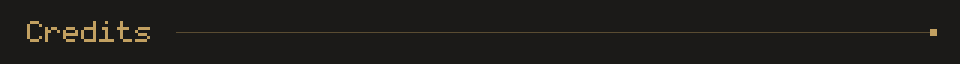

Made by **Oliver Pearce**. 

- **Icons:** [Raven Fantasy Icons](https://clockworkraven.itch.io/raven-fantasy-icons) by Clockwork Raven Studios
- **Character sprites:** Fantasy Knight by aamatniekss
- **Effects:** [Super Pixel Effects Gigapack](https://untiedgames.itch.io/super-pixel-effects-gigapack) by Will Tice / unTied Games
- **Tiles:** [Cyber City](https://opengameart.org/content/cyber-city) by warlloyd (CC0)
- **Font:** monogram by datagoblin

Third-party art keeps its own licence (see each `CREDITS.md`), and isn't covered by any licence on this repository.
